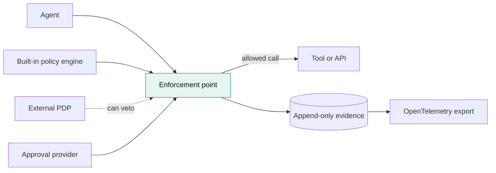
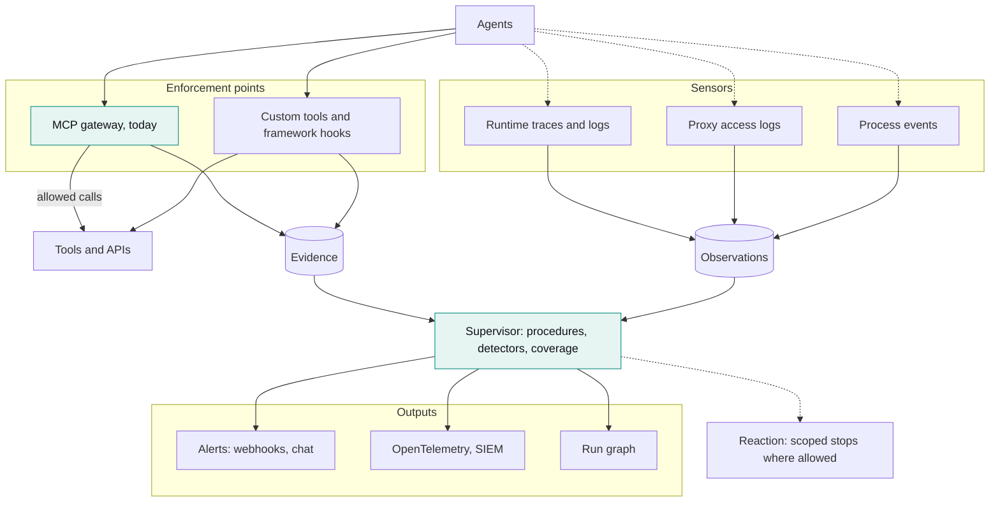
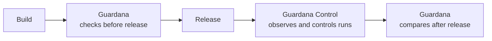

<div align="center">

#  Guardana Control

**Supervise your AI agents. Decide what runs.**

An open-source AI agent supervision framework that checks recorded runs against procedures and uses policy to decide connected actions.

[](https://github.com/guardana/control/actions/workflows/ci.yml)
[](https://github.com/guardana/control/actions/workflows/security.yml)
[](https://scorecard.dev/viewer/?uri=github.com/guardana/control)
[](https://www.bestpractices.dev/projects/15118)
[](https://github.com/guardana/control/releases)
[](go.mod)
[](LICENSE)
[](docs/status.md)

[Website](https://control.guardana.dev) · [Try the demo](docs/get-started/try-the-demo.md) · [Docs](docs/index.md) · [Status](docs/status.md) · [Roadmap](ROADMAP.md) · [Contributing](CONTRIBUTING.md) · [Security](SECURITY.md)

</div>

## Try the alpha

[Run the local demo](docs/get-started/try-the-demo.md): allow a call, block
another and approve one exact action, without Go or a model key.
[Connect your MCP setup](docs/guides/connect-an-existing-mcp-setup.md) afterwards.

The gateway is `experimental`. Caller identity comes from configuration.
The evidence trail is not tamper-evident. Do not deploy this as a security
boundary. [Status](docs/status.md) is the inventory of what exists.

## What you can do today

- Hold writes for an expiring approval of one exact action:
  [starter policies](docs/reference/starter-packs.md).
- Let your existing authorization service veto configured calls through the
  [AuthZEN API](docs/guides/let-a-decision-point-veto.md).
- Let a tool of your own ask before it acts and report how it ended, through
  the [Enforcement API](docs/guides/decide-a-tool-of-your-own.md).
- Import runtime traces, inspect coverage, check a recorded run against its
  procedure, and stop its later calls where a signed route allows:
  [supervision](docs/guides/supervise-and-stop-a-run.md).
- Block a tool whose definition no longer matches its reviewed fingerprint:
  [MCP gateway](docs/concepts/mcp-gateway.md).

Supervision and reaction run when you invoke them. A stop does not interrupt
an operation already running. Paths around the gateway stay outside its control.

## The 1.0 goal: observe, supervise, react

Guardana Control is a control and supervision layer for AI agents. Its 1.0
goal is `planned` ([roadmap](ROADMAP.md)):

- **Observe** actions and outcomes across connected tools, APIs, runtimes,
  network and process sources. State each path's coverage, source trust and gaps.
- **Supervise** runs against procedures and permissions. Report deviations,
  denied actions tried another way, skipped work and uncertain outcomes.
- **React** within scoped authority: inform, alert, request review, hold an
  exact action for approval, pause calls or stop further actions.

Full observation means coverage of connected paths with unknowns visible.
It does not mean every action is visible or controllable. Sensors report;
enforcement points decide before effects. Read
[the product model](docs/concepts/control-and-supervision.md).

## How a call is decided

The MCP gateway consults signed policy before a tool call. An external PDP
can veto but never widen local authority (`experimental`). Its silence blocks
the calls it governs in an enforcing mode. It receives action metadata, not
arguments. Evidence names the policy version and records the outcome.



Decisions do not wait for evidence export. A full spool blocks calls unless
the operator explicitly let a read run unrecorded.

| Verdict | Under `ENFORCE` |
| --- | --- |
| `ALLOW` | Proceed. |
| `DENY` | Block. |
| `REQUIRE_APPROVAL` | Hold this exact action for one approval. |
| `ALLOW_WITH_OBLIGATIONS` | Proceed under enforced conditions, unless advisory. |
| `INDETERMINATE` | No decision; never an allow. |

`OBSERVE` records decisions and lets calls run. No model grants authority.
Content capture is off by default; hidden reasoning is never stored.

## Connected channels towards 1.0

The `planned` target connects enforcement and observation through one
vocabulary ([ADR-0039](docs/adr/0039-many-channels-into-one-core.md)).
An [Enforcement API](docs/adr/0051-a-tool-outside-mcp-is-admitted-completed-and-aborted-through-an-enforcement-api.md)
(`experimental`) is distinct from AuthZEN vetoes: custom tools ask before
acting and report completion or abort. A cooperating client enforces its answer; that path is
decided, not enforced by the receiver.



## Install

Each release has archives for Linux and macOS on amd64 and arm64, holding both
binaries, `guardana-gateway` and `guardana-control`. Download one from the
[releases page](https://github.com/guardana/control/releases), check it against
the signed `checksums.txt` as [RELEASING.md](RELEASING.md) shows, and put the
binaries on your `PATH`.

With Go 1.27.2 or later, build from source; such a binary reports version
`dev`:

```bash
go install github.com/guardana/control/cmd/guardana-gateway@latest
go install github.com/guardana/control/cmd/guardana-control@latest
```

## Related project: Guardana

[Guardana](https://github.com/guardana/guardana) verifies AI systems before
and after deployment. Control observes and controls agents while they run.
The projects are independent.



[Governance](GOVERNANCE.md) · [Decision records](docs/adr/README.md) ·
[Code of conduct](CODE_OF_CONDUCT.md) · [Trademarks](TRADEMARKS.md)
