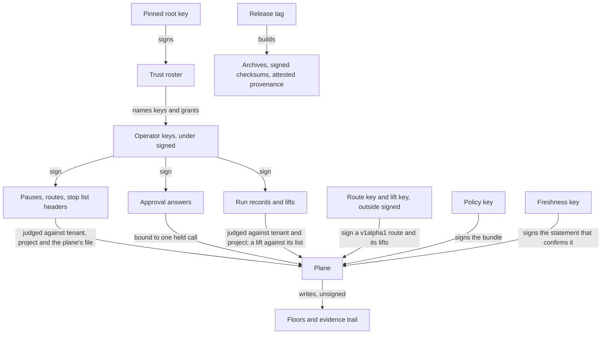

# Signed operations

A plane takes its policy, and under `approvals.authority: signed` the
operators' answers, pauses, runs and stops, only with a signature it checks;
a stop route carries one at every setting. [status.md](../status.md) is the
inventory, and
[contracts.md](../contracts.md#signed-files-and-their-project-checks) lists
each signed file a plane takes with its project check and the test behind it.
Nothing in this repository is a security boundary yet.

## Who signs what

Sources: `internal/trust/file.go`, `internal/policy/bundle/bundle.go`,
`internal/policy/statement.go`, `internal/gateway/authority.go`,
`internal/pause/signedpause/judge.go`, `internal/reaction/header2.go`,
`internal/reaction/lift2.go`, `internal/reaction/judge.go`,
`internal/gatewayconfig/reaction.go`, `internal/evidence/chain.go`,
`.goreleaser.yaml`.

| What is signed | By whom | What the plane checks | Status | Where |
| --- | --- | --- | --- | --- |
| The policy bundle | the holder of the policy key, with `policy sign` | an Ed25519 signature over the DSSE encoding of the bundle's canonical bytes, under the bundle's payload type, by a key the plane pins; a holder pinned to one bundle id refuses every other | `implemented` | `internal/policy/bundle/`, `internal/policy/holder.go` |
| The freshness statement and the serial floor | the holder of a second key, the freshness key, with `policy renew` | a statement bound to the bundle's id, serial and digest, signed by the freshness key, which may not be the bundle's key; the floor keeps a bundle from going back | `experimental` | `internal/policy/statement.go`, `internal/policy/floor.go`, `internal/policystate/` |
| The trust roster | the holder of the root key, with `operators roster sign` | a roster signed by the pinned root, of the configured id, unexpired, with a serial that only climbs; it names each operator's key and grants of tenant, project and level | `experimental` | `internal/trust/` |
| Approval answers, pause files, run records, routes, stop list headers and lifts | roster operators, each with `--key` on its own command | under `approvals.authority: signed` only: the signer is a roster operator whose grant covers the act, the tenant and the project; a pause file, a route and a stop list header also name the file the plane reads, an answer the held call, and a lift the list it was made against | `experimental` | `internal/gateway/authority.go`, `internal/pause/signedpause/`, `internal/runs/signedruns/`, `internal/reaction/` |
| A `v1alpha1` route and its lifts | outside `signed`: the holder of the route key, with `route sign`, and the holder of the lift key the route names, with `stops lift` | the route verifies under `reaction.public_key` and names the listener's tenant, and no project; a lift verifies under the route's lift key; the route, lift, policy and freshness keys are four different keys | `experimental` | `internal/gatewayconfig/reaction.go`, `internal/reaction/route.go`, `internal/reaction/judge.go` |
| Releases | the release workflow, from a tag on `main` | not a plane's check: `checksums.txt` is signed without a stored key, and each archive and the image carry a build provenance attestation, which a user verifies with the commands in [RELEASING.md](../../RELEASING.md) | `experimental` | `.goreleaser.yaml`, `.github/workflows/release.yml` |

## What a signature proves here

A bundle's signature proves that the holder of the pinned policy key signed
those exact bytes as a policy; the bundle digest every decision records names
them. A freshness statement records that the freshness key's holder signed
for that bundle's id, serial and digest at a stated time. The floor refuses
an older bundle, and a snapshot no statement confirms decides
`POLICY_STALE`. A roster proves that the root key's holder named these
operators with these grants until its expiry.

Under `signed`, an operator's signature proves that a key the roster names
signed this answer, pause, run, route, header or lift, and the plane counts
it only within that operator's grant over the tenant and project it names,
which have to be the ones the plane serves. A signed pause file, route or
stop list header names the file it was signed for, and a plane refuses one
that names another. An answer counts for the one held call it names, by its
tenant, project, request, approval, action digest and bundle digest, and only
the plane marks it spent ([approvals](approvals-and-the-held-call.md)).
Outside `signed`, a route's signature proves only that the route key's holder
signed it, and a lift's that the lift key's holder did.

The certificate on the signature of `checksums.txt` names the release
workflow and the tag; each attestation names the workflow and the source an
archive was built from.

## What is not signed

- **The evidence trail.** Events are linked by order, not by hash, and no
  checkpoint is signed; whoever can write the trail can rewrite it. Hash
  links and signed checkpoints are backlog task B29, `planned`
  ([threat model](threat-model.md#evidence-what-a-trail-proves)).
- **The floors.** The policy serial floor, the roster's floor and the pause,
  route and stop list floors are state the plane's account writes itself, as
  is the time a restore stamps on them. That account can lower one, or
  withhold a newer roster until the held one expires.
- **The backup manifest.** Its hashes catch a corrupted backup, not a hostile
  writer of it ([back up and restore](../guides/back-up-and-restore-a-plane.md)).
- **The lines `react` writes.** A stop line is signed by no operator. It
  counts only where the route permits it: under a `v1alpha2` route a stop of
  its project and scope, under a `v1alpha1` route a stop of its tenant.
- **Answers, pauses and run records outside `signed`.** Under `directory` or
  `memory`, write access to where the plane reads them is the authority, and
  `approver_id` is a claim recorded as given.

## What a signature does not prove

- **That the signer was right.** A signed policy can allow the wrong call,
  and an operator can approve the wrong action. The signature names who
  decided, not whether they should have.
- **That a key was held by the person it names.** Whoever holds a key file
  signs as its owner; the account that can read a key can use it.
- **That a cooperating client obeyed.** A tool behind the enforcement API
  receives a decision; the receiver cannot prove the tool followed it.
- **Anything about a path the plane does not see.** A call that goes around
  the plane is decided by no signed policy, and a signature on a stop reaches
  only the enforcement paths that read the list
  ([control and supervision](control-and-supervision.md)).
- **That a release's commit was reviewed.** The attestation names the
  workflow and the source, not who looked at it.

The record of what happened is the part not built yet, and the
[backlog](../backlog.md) holds it as B29.

## Why

- A policy is the authority over every call, so it counts only signed by a
  key the plane pins; the signature is Ed25519 over DSSE, and the key id only
  selects a key the operator pinned (ADR-0011).
- A signed policy can be replayed, so a second key confirms that it is
  current and a floor keeps it from going back (ADR-0038).
- Write access to a directory names no person, so under `signed` operators
  are named by a roster signed under a pinned root (ADR-0071), and an
  approval, a pause, a run and a stop list count only as the plane judges
  their signatures (ADR-0073, ADR-0075, ADR-0076, ADR-0077).
- Each decision about keys, signers and algorithms is a port, so a key store
  or algorithm can change without a fork (ADR-0066).
- A release tag is the root of every signature and attestation of that
  release: the workflow builds every asset from the tag, signs the checksums
  and attests every archive before it publishes, and no tag moves (ADR-0025).

## Where the code lives

`internal/policy/bundle/` signs and verifies bundle bytes, and
`internal/policy/holder.go`, `statement.go` and `floor.go` pin, confirm and
floor them; `internal/policykey/` reads the key files. `internal/trust/` holds
the roster and `internal/operators/` the authenticator and authorizer over it.
`internal/gateway/authority.go` judges an approval answer,
`internal/pause/signedpause/` a pause file and `internal/runs/signedruns/` a
run record. `internal/reaction/` verifies routes, stop list headers and lifts,
and `internal/gatewayconfig/reaction.go` checks a route at start.
`internal/policystate/` keeps the floors. The commands that sign are in
`cmd/guardana-control/`; the release signing is in `.goreleaser.yaml` and
`.github/workflows/release.yml`.
